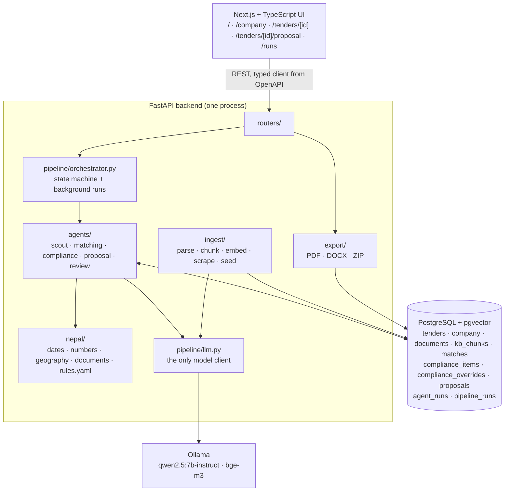
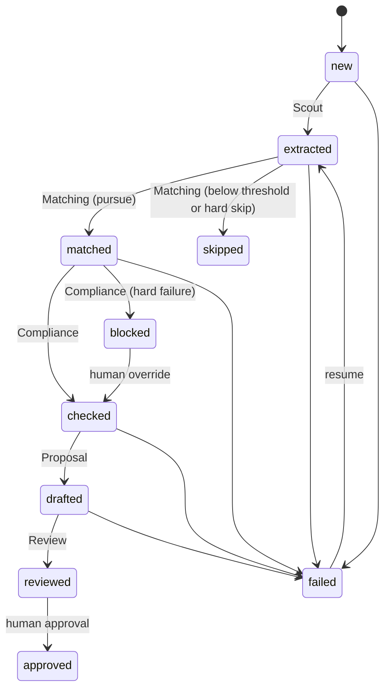

# Architecture

This is the as-built architecture (spec §8, §8.1, §8.2, §10), with the places where the build differs from the spec
marked "Deviation". Project rules and the full file layout are in [`CLAUDE.md`](CLAUDE.md); Nepal-specific facts
are in [`docs/NEPAL_CONTEXT.md`](docs/NEPAL_CONTEXT.md); which output is consumed by which code is in
[`AI_DISCLOSURE.md`](AI_DISCLOSURE.md).

## 1. System overview

All stages run inside the FastAPI backend. Each reads from and writes to PostgreSQL, so runs are resumable and
auditable. The frontend talks only to the REST API (`web/lib/api/tenderly.ts`, types generated from the OpenAPI
schema). Docker Compose runs four services: `web`, `api`, `db` (`pgvector/pgvector:pg16`) and `ollama`.

### Design rules (spec §8.2, as enforced)

| Rule                                                                                                                         | Where it is enforced                                                                                                                                                                                                       |
| ---------------------------------------------------------------------------------------------------------------------------- | -------------------------------------------------------------------------------------------------------------------------------------------------------------------------------------------------------------------------- |
| Every LLM call is JSON-schema constrained and Pydantic validated; invalid output gets one retry, then the stage is `failed`. | `pipeline/llm.py::LLMClient.chat` (Ollama `format` = the Pydantic schema, strict validation, one retry that feeds the error back, then `LLMOutputError`). Never silently coerced.                                          |
| Temperature 0 for extraction, matching, compliance and review; low to moderate for proposal text.                            | `STAGE_TEMPERATURE` in `pipeline/llm.py`; only `proposal` may be overridden (at most 0.7). Proposal sections use 0.4.                                                                                                      |
| Deadline, budget, expiry and score-threshold checks are code. The LLM only extracts values.                                  | `nepal/` (parsers, dates, rules), `agents/matching.py::combine`, `agents/review.py::decide_verdict`, `ComplianceReport.is_blocked`.                                                                                        |
| Proposal text cites KB chunk ids; ungrounded sections are flagged.                                                           | `agents/proposal.py::build_section` and `agents/review.py::run_checks` (`sections_cited`). Compliance evidence without a chunk id is `unclear`, never `pass` (`agents/compliance.py::ground`, `ComplianceItem` validator). |
| No stage submits anything externally.                                                                                        | No stage logs in to, posts to, or uploads to any portal. The scraper is read-only (`ingest/scraper.py`). The package audit summary carries `submitted: false`.                                                             |
| One model client, open-weight models only.                                                                                   | `pipeline/llm.py`; `tests/test_no_proprietary.py` fails on any other model call, SDK, key or hosted default.                                                                                                               |
| Every stage writes an `agent_runs` row (stage, model, input hash, output JSON, latency, ok).                                 | `LLMClient` (one row per call, success or failure); code-only steps write `model="deterministic"`; human actions write `model="human"`.                                                                                    |

## 2. Pipeline orchestration

The orchestrator is a plain Python state machine (`pipeline/orchestrator.py::TRANSITIONS`), not an agent framework.

- **Resting statuses only.** Agents commit only these statuses. `failed` is reached by an invalid LLM output after
  one retry, a timeout, a crash or an illegal edge. A failed tender's resume point is derived from stored data
  (`resume_status`: no record, Scout; no match row, Matching; a pursued match, Compliance; stored compliance items
  that do not block, Proposal; a stored proposal version, Review), because each failing stage drops its own
  partial output.
- **Runs.** `POST /tenders/{id}/analyze` calls `start_run` (a `queued` row in `pipeline_runs`; a partial unique
  index allows one queued or running run per tender, otherwise 409) and returns 202. `execute_run` then runs in a
  FastAPI `BackgroundTasks` (no queue). After each stage the orchestrator checks that the tender moved along a legal
  edge; otherwise the tender becomes `failed` and an `agent_runs` row with `model="orchestrator"` is written. Runs end
  `succeeded`, `stopped` (a skipped or blocked branch is an expected outcome, not an error) or `failed`.
- **Stuck runs.** `reap_stale_runs` fails queued or running runs at startup and, on `GET /runs*`, once the heartbeat
  is older than `PIPELINE_STALE_AFTER_S` (600 s). Each model call and each proposal section bumps the heartbeat.
- **Human edges.** Override (`blocked`, then `checked`) and approval (`reviewed`, then `approved`) are only ever set
  by a person through the API. An approved tender is never re-run.
- **Progress.** A stage with items (Proposal sections) reports `StageProgress` through a ContextVar callback into
  `StageRun.progress`; the UI polls `GET /runs/{id}` every 2 s.
- **Deviation (spec §10.2).** `POST /tenders/{id}/analyze` returns 202 plus a pipeline run instead of a tender
  detail, and `POST /tenders/{id}/proposal` runs Proposal and Review (target `reviewed`). Scheduled scouting
  (APScheduler) is not wired: `POST /tenders/scrape` is on demand.

## 3. Agent contracts (as built)

The LLM never fills the record that code acts on. It fills a narrow model (second column); code validates it,
adds everything that is a decision or a conversion, and builds the stored contract (third column).

| Stage                                               | Input                                                                                                       | The LLM fills (`schemas/`)                                                                                                                  | Code builds and stores                                                                                                                                                                                                                                                                                                                                                                                                                                                                                                                 | Consumed by                                                                                                                                                                                          |
| --------------------------------------------------- | ----------------------------------------------------------------------------------------------------------- | ------------------------------------------------------------------------------------------------------------------------------------------- | -------------------------------------------------------------------------------------------------------------------------------------------------------------------------------------------------------------------------------------------------------------------------------------------------------------------------------------------------------------------------------------------------------------------------------------------------------------------------------------------------------------------------------------- | ---------------------------------------------------------------------------------------------------------------------------------------------------------------------------------------------------- |
| **Scout** `agents/scout.py`                         | Raw notice text (`tenders.raw_text`)                                                                        | `TenderExtraction` (`scout.py`): every value is a `{value, quote}` pair of verbatim strings, with no conversions.                           | `TenderRecord` (`tender.py`) via `postprocess`: deadline (BS and AD) from `nepal.parse_deadline`, amounts from `parse_npr`, security and validity from `parse_percent` / `parse_days`, location from `normalize_location`, document types from `classify_document`, bid security due from `calc_bid_security`, `language` computed, `sources[]` and `review_flags`. A value not verbatim in the notice, or that does not parse, becomes null with a flag and `needs_review`. Stored in `tenders.record_json` and denormalised columns. | Deadline and budget columns feed filters and Matching; the record feeds Compliance and Proposal.                                                                                                     |
| **Matching** `agents/matching.py`                   | `TenderRecord`, `CompanyProfile`, top-k KB chunks (`MATCH_TOP_K`)                                           | `MatchAssessment`: scope relevance score and reasons only. The prompt withholds deadline, cost and location.                                | `MatchResult` via `combine`: 100 deterministic fit points (type 30, district 30, cost versus turnover 25, deadline 15), a failed check is a hard skip; score = `MATCH_LLM_WEIGHT` x semantic + the rest x deterministic; a hard skip caps the score at threshold-1; decision `pursue` iff score >= `MATCH_THRESHOLD` (60) and no hard skip. Reasons are tagged `[deterministic]` or `[model]`. One `matches` row per tender.                                                                                                           | Ranking in `GET /tenders`; the decision sets `matched` or `skipped`, and Compliance runs only on `matched`.                                                                                          |
| **Compliance** `agents/compliance.py`               | `TenderRecord`, `CompanyProfile`, `DocumentMeta` (type, expiry, FY, chunk id), KB retrieval per requirement | `ComplianceAssessment`: ONE requirement per call (status, chunk ids, quote, explanation). No severity, no rule id.                          | `ComplianceReport` (`compliance.py`): Layer 1 `nepal.rules.evaluate_rules` (14 rules in `rules.yaml`), Layer 2 one model call per requirement the rules do not cover, then `ground()` downgrades a pass or fail to `unclear` unless the cited chunk was shown and the quote is verbatim in it. Severity is code's (mandatory means hard). Every item has `source`, evidence ids, `action_needed`; a pass needs a chunk or a notice field.                                                                                              | `ComplianceReport.is_blocked` (a `fail` with `hard` severity) sets status `blocked`; `proposal_allowed()` gates `POST /tenders/{id}/proposal`; a named override stores which failures were accepted. |
| **Proposal** `agents/proposal.py`                   | `TenderRecord`, company profile, compliance report, per-section KB retrieval                                | `ProposalSectionDraft`: body with placeholders, cited chunk ids, verbatim facts, missing items.                                             | `ProposalSection[]` via `plan_sections` (code templates by procurement family, reordered and extended by requirement category) and `build_section`: unshown citations dropped, facts checked verbatim, `{{company.*}}`, `{{tender.*}}`, `{{today}}` filled from records, figures the model typed itself masked as `⟦unsourced: …⟧`, flags added. No KB chunk means no model call (a `no_kb_material` stub). A new `proposals` row per version; none is overwritten.                                                                    | `export/` assembles the document from the sections; `agents/review.py` reads them.                                                                                                                   |
| **Review** `agents/review.py`                       | Proposal version, `TenderRecord`                                                                            | `ReviewAssessment`: three 0-100 scores and gaps tied to a real section key or requirement index (schema narrowed per proposal). No verdict. | `ReviewReport`: deterministic checks (`mandatory_addressed` hard, `no_placeholders`, `bid_security_stated`, `deadline_not_passed` hard, `sections_cited`) plus `decide_verdict` (`fail`, `needs_work`, `pass`). If not `pass`, one automatic revision pass redrafts only the named sections as a new version, reviewed once.                                                                                                                                                                                                           | The verdict sets the proposal status; `fail` blocks approval; gaps feed the revision.                                                                                                                |
| **Human gate** `agents/review.py::approve_proposal` | A reviewed version                                                                                          | None                                                                                                                                        | Refused (409) unless: reviewed, verdict not `fail`, opened after its review (`POST /proposals/{id}/open`), the latest version, tender `reviewed`, no active run. Writes an audit row (`model="human"`) and sets version and tender `approved`.                                                                                                                                                                                                                                                                                         | `GET /proposals/{id}/package` and `/export/{fmt}` are served for approved versions only.                                                                                                             |

**Deviations from spec §8.1:** the LLM fills `TenderExtraction`, `MatchAssessment`, `ComplianceAssessment`,
`ProposalSectionDraft` and `ReviewAssessment`; the spec's `TenderRecord`, `MatchResult`, `ComplianceReport`,
`ProposalSection[]` and `ReviewReport` are code-built contracts with additive fields. Compliance asks one
requirement at a time rather than one list. `ReviewReport` has the extra verdict `needs_work`.

## 4. Retrieval and ingestion

- **Knowledge base.** `POST /company/documents` stores the original (`documents.content`) and runs
  `ingest/kb.py::ingest_document` as a background task: parse (`ingest/parse_docs.py`: PyMuPDF, python-docx, UTF-8
  text; scanned PDFs become `needs_ocr`, with warnings for legacy Nepali fonts), chunk (`ingest/chunking.py`: 400-600
  estimated tokens, 80 overlap, splits on `.`, `!`, `?` and the danda), embed (`ingest/embed.py::embed_chunks`,
  bge-m3, 1024 dimensions), write `kb_chunks.embedding VECTOR(1024)` with an HNSW cosine index. The result is in
  `documents.ingest_status`.
- **Retrieval.** `db/search.py::search_chunks` is a pgvector top-k by cosine distance, filtered by company and
  document type, over `ready` documents only; `retrieve` embeds the query through `LLMClient`. Matching,
  Compliance (per requirement) and Proposal (per section) call it; each cites `ChunkHit.chunk_id`.
- **Tenders.** `POST /tenders/scrape` loads `data/seed_tenders/` (37 synthetic notices, the primary demo source) or
  runs the live scraper (`ingest/scraper.py`: robots.txt first, at least 10 s between requests, honest user agent,
  no login, no redirects, stops on 401/403/429). Both produce `RawNotice`s upserted by `source_url`; new rows hold
  raw text only and Scout does all extraction. Changed text resets a tender to `new`.

## 5. The model client and the replay cache

`pipeline/llm.py::LLMClient` is the only module that talks to a model. `chat()` returns a validated model or raises
`LLMOutputError` or `LLMTransportError`, and always writes exactly one `agent_runs` record. `embed()` returns
1024-dimension vectors and writes no row. The endpoint and models come from `LLM_BASE_URL`, `LLM_MODEL`,
`EMBED_MODEL`; the context window from `LLM_NUM_CTX` (8192); the per-call timeout from `LLM_TIMEOUT_S` (180 s).

**Pre-cached demo (spec §14).** `ReplayCache` (`LLM_REPLAY_CACHE`, read-only at run time) answers a request whose
hash (model, stage, messages, schema, temperature) it holds, re-validated strictly, and the `agent_runs` row is
marked `cached`. A miss calls the live model. `scripts/precache_demo.py` records the file; `--check` replays with
all HTTP refused. `DEMO_NOW` pins the clock so Review can replay.

## 6. Data model

| Table                                      | Holds                                                                                                                       |
| ------------------------------------------ | --------------------------------------------------------------------------------------------------------------------------- |
| `company`                                  | The single company profile (`profile_json`)                                                                                 |
| `documents`                                | KB documents: original bytes, `doc_type`, `expires_on`, `fiscal_year_bs`, `value_npr`, ingest status and warnings           |
| `kb_chunks`                                | Chunk text and `embedding VECTOR(1024)`                                                                                     |
| `tenders`                                  | Raw text, status, `record_json`, denormalised deadline (AD and BS), cost, location, language                                |
| `matches`                                  | One row per tender: score, decision, the full `MatchResult`                                                                 |
| `compliance_items`, `compliance_overrides` | Per-requirement results with evidence ids; who accepted which hard failures and why                                         |
| `proposals`                                | Versioned sections JSON, language, review report, approval (by, when, note), `reviewed_at`, `opened_at`                     |
| `agent_runs`                               | The audit log: stage, model, input hash, output JSON, latency, ok, attempts, error, raw output, `cached`, `pipeline_run_id` |
| `pipeline_runs`                            | One row per orchestrated pass: target, status, stages JSONB with durations and progress, heartbeat                          |

Schema source of truth: Alembic migrations (`api/alembic/versions/`, `0001` to `0005`). Enum columns are TEXT with
CHECK constraints generated from `schemas/enums.py`, and `tests/test_db.py::test_migration_matches_models` fails
on drift. **Deviations from spec §11:** `tenders.budget` is `estimated_cost_npr`; timestamps are `TIMESTAMPTZ`;
`pipeline_runs`, `compliance_overrides` and several evidence columns are additions.

## 7. API (spec §10.2, as built)

| Route                                                              | Purpose                                                                              |
| ------------------------------------------------------------------ | ------------------------------------------------------------------------------------ |
| `POST /tenders/scrape`                                             | Load seed notices (default) or run the live scraper                                  |
| `GET /tenders`, `GET /tenders/{id}`                                | Ranked list with filters; one tender with record, match, compliance, latest proposal |
| `POST /tenders/{id}/analyze`                                       | Background run: Scout, Matching, Compliance (202 plus run)                           |
| `POST /tenders/{id}/compliance/override`                           | A named person accepts the current hard failures                                     |
| `POST /tenders/{id}/proposal`                                      | Background run: Proposal and Review (409 while blocked)                              |
| `GET /tenders/{id}/proposals`, `GET /proposals/{id}`               | Proposal versions                                                                    |
| `POST /proposals/{id}/open`, `/approve`                            | Human gate                                                                           |
| `POST /proposals/{id}/sections/{key}/edit`, `/review`              | Edit makes a new version; re-review without auto-revision                            |
| `GET /proposals/{id}/checklist`, `/export/{pdf\|docx}`, `/package` | Checklist (any version); documents and ZIP (approved only)                           |
| `POST /company`, `GET /company`, `POST/GET /company/documents`     | Profile and knowledge base                                                           |
| `GET /runs`, `GET /runs/{id}`, `GET /agent-runs`                   | Pipeline runs and the audit log                                                      |
| `GET /rules`, `GET /chunks?ids=`                                   | Rule metadata and cited chunk text for the compliance matrix                         |

## 8. Frontend

Next.js 16 (App Router, `cacheComponents`), TypeScript, Tailwind, shadcn/ui, served with Bun. Server components
fetch lists (with `connection()` inside `<Suspense>`); small client leaves read the language and calendar
preferences. `lib/api/tenderly.ts` is the only place pages call the API, with an explicit mock fallback
(`NEXT_PUBLIC_USE_MOCKS=1`, always bannered). Every UI string is in `lib/i18n/dict.ts` in English and Nepali. The BS
calendar table is exported from the backend. The proposal page shows each section next to its citations and the
requirement it answers, and the approval panel mirrors the backend's `approval_blockers`.

## 9. Export

`export/content.py` builds one document model that `export/pdf.py` (ReportLab with HarfBuzz shaping and embedded Noto
fonts; `export/shaping.py` patches ReportLab so Devanagari renders and extracts correctly) and `export/docx.py`
(python-docx with complex-script fonts) both render. `export/package.py` builds the ZIP: the PDF and DOCX, an
attachment checklist CSV, a JSON audit summary and the KB originals. Contents: `docs/NEPAL_CONTEXT.md` §16.

**Deviation (spec §7):** ReportLab is used instead of WeasyPrint, which needs system libraries that are not
pip-installable.

## 10. Failure handling (spec §10.5)

| Failure                           | Behaviour                                                                                                           |
| --------------------------------- | ------------------------------------------------------------------------------------------------------------------- |
| Model returns invalid JSON        | One retry with the validation error; then `LLMOutputError`, stage `failed`, an `agent_runs` row with the raw output |
| Model timeout or Ollama down      | `LLMTransportError`, tender `failed`; the next run resumes at the last good state (`tests/test_failure_drills.py`)  |
| Stage crash or illegal transition | Rolled back, tender `failed`, `agent_runs` row with `model="orchestrator"`                                          |
| Worker dies mid-run               | The reaper marks the run `failed`; tender statuses are only ever committed as resting values                        |
| Scraper blocked                   | Reported, nothing retried; the seed set is the demo source                                                          |
| Slow inference on demo hardware   | Replay cache of pre-analysed tenders; GPU override for Ollama                                                       |

## 11. Known limits of this design

One process: background tasks share the API process, so run a single worker. The reaper assumes a stage reports
progress at least every 600 s. Replay-cache keys include prompts, which cite KB chunk ids, so the cache must be
recorded against the KB the demo uses (a fresh DB seeded once gives the same ids). See [README](README.md#limitations)
for product limitations.
